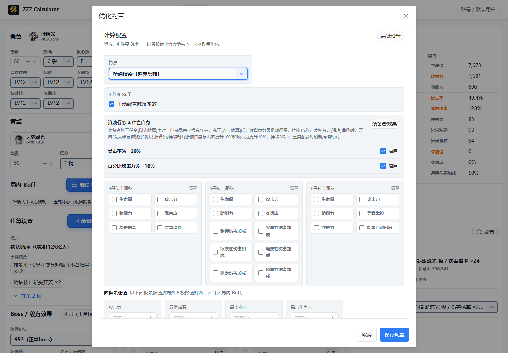
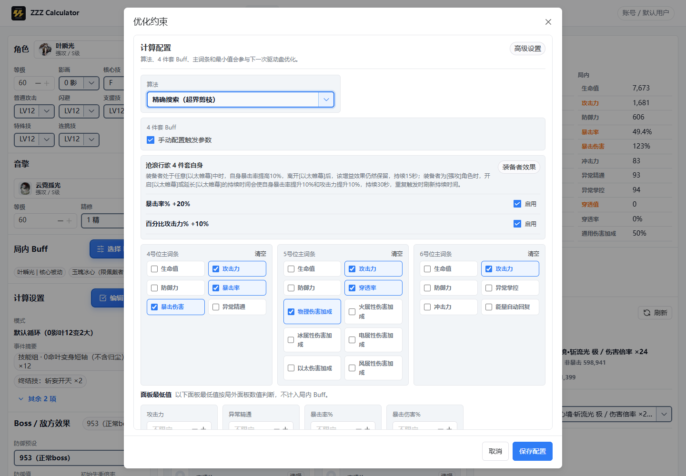

# 优化器推荐显示对比

2026-10-21，Windows / Microsoft Edge，视口 1440 × 1000。
改前基线为 `origin/main` 的 `fa53242`；改后为本 PR。
两侧均使用隔离浏览器中的叶瞬光首次配置，没有读取真实账号或库存。

改前界面未显示内核实际使用的主词条推荐；改后在首次配置中明确勾选这些推荐。
保存、清空及旧设置兼容规则见[优化器回归约定](../../regression-contract.md#优化器)。

| 系统偏好 | 改前 | 改后 |
| --- | --- | --- |
| 浅色 |  |  |
| 深色 |  |  |

当前上游只提供浅色主题；第二行真实启用了浏览器的深色偏好，页面仍采用上游浅色样式。本 PR 不新增暗色模式。
